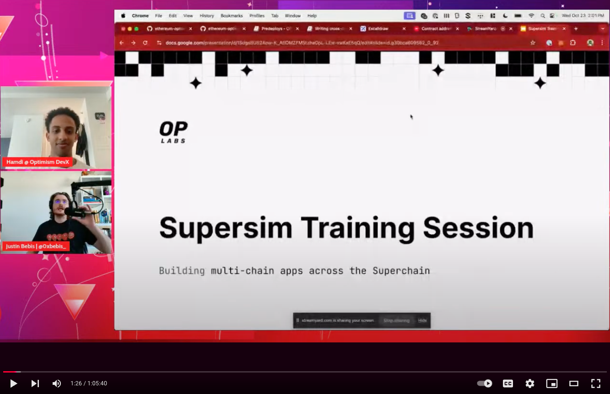

# 🛠️ Supersim

**Supersim is a lightweight tool to simulate the Superchain locally** (with a single L1 and multiple OP-Stack L2s).

### ✨ Features 

- spin up multiple anvil nodes
- predeployed OP Stack contracts and useful mock contracts (ERC20)
- fork multiple remote chains (fork the entire Superchain)
- simulate L1 <> L2 message passing (deposits) and L2 <> L2 message passing (interoperability)


For **detailed instructions** and **usage guides**, refer to the [**📚 Supersim docs**](https://supersim.pages.dev).

## 🚀 Getting Started

### 1. Install prerequisites: `foundry`

`supersim` requires `anvil` to be installed.

Follow [this guide](https://book.getfoundry.sh/getting-started/installation) to install Foundry.

### 2. Install `supersim`

#### Homebrew (OS X, Linux)

```sh
brew install ethereum-optimism/tap/supersim
```
#### Precompiled Binaries

Download the executable for your platform from the [GitHub releases page](https://github.com/ethereum-optimism/supersim/releases).

### 3. Start `supersim` in vanilla mode

```sh
supersim
```
Vanilla mode will start 3 chains, with the OP Stack contracts already deployed.

```
Chain Configuration
-----------------------
L1: Name: Local  ChainID: 900  RPC: http://127.0.0.1:8545  LogPath: /var/folders/y6/bkjdghqx1sn_3ypk1n0zy3040000gn/T/anvil-chain-900-3719464405

L2s: Predeploy Contracts Spec ( https://specs.optimism.io/protocol/predeploys.html )

  * Name: OPChainA  ChainID: 901  RPC: http://127.0.0.1:9545  LogPath: /var/folders/y6/bkjdghqx1sn_3ypk1n0zy3040000gn/T/anvil-chain-901-1956365912
    L1 Contracts:
     - OptimismPortal:         0xF5fe61a258CeBb54CCe428F76cdeD04Cbc12F53d
     - L1CrossDomainMessenger: 0xe5bda89cd85cE0DfB80E053281cA070D65B738e6
     - L1StandardBridge:       0xa01ae68902e205B420FD164435F299E07b0C778b

  * Name: OPChainB  ChainID: 902  RPC: http://127.0.0.1:9546  LogPath: /var/folders/y6/bkjdghqx1sn_3ypk1n0zy3040000gn/T/anvil-chain-902-1214175152
    L1 Contracts:
     - OptimismPortal:         0xdfC9DEAbEEbDaa7620C71e2E76AEda32919DE5f2
     - L1CrossDomainMessenger: 0xCB9768921831677Ae15cE4B64A10B94F49cD88E2
     - L1StandardBridge:       0x2D8543c236a4d626f54B51Fa8bc229a257C5143E
```


### 4. Start testing multichain features 🚀 

For **getting up to speed with supersim**, watch the [**🎥 Supersim 101 Training Session video**](https://www.youtube.com/live/Kh4fNshcl5Y?t=30s)

[](https://www.youtube.com/live/Kh4fNshcl5Y?t=30s)

More examples below!

## 🐋 Running with Docker

To simplify the process, you can now run Supersim using Docker. This approach ensures a consistent development environment without needing to install dependencies on your local machine. Here are the steps:

### 1. Build the Docker image
   ```bash
   docker build -t supersim .
   ```

### 2. Run Supersim in Docker
   ```bash
   docker run --rm -it --network host supersim:latest
   ```

This setup encapsulates Supersim in a container, isolating it from the host system. This ensures a clean, conflict-free environment and provides an added layer of security by reducing the application's permissions on the host.

### 3. Start testing multichain features 🚀

Some examples below! 

## 🔀 First steps

### Example A: (L1 to L2) Deposit ETH from the L1 into the L2

**1. Check initial balance on the L2 (chain 901)**

Grab the balance of the sender account on L2:

```sh
cast balance 0xf39Fd6e51aad88F6F4ce6aB8827279cffFb92266 --rpc-url http://127.0.0.1:9545
```

**2. Retrieve the `L1StandardBridge` address for the chain you would like to bridge to from the `Chain Configuration` section printed in the terminal where supersim is running**

**3. Call `bridgeETH` function on the `L1StandardBridge` contract on the L1 (chain 900)**

Initiate a bridge transaction on the L1:

```sh
cast send <L1StandardBridgeAddress> "bridgeETH(uint32 _minGasLimit, bytes calldata _extraData)" 50000 0x --value 0.1ether --rpc-url http://127.0.0.1:8545 --private-key 0xac0974bec39a17e36ba4a6b4d238ff944bacb478cbed5efcae784d7bf4f2ff80
```

**4. Check the balance on the L2 (chain 901)**

Verify that the ETH balance of the sender has increased on the L2:

```sh
cast balance 0xf39Fd6e51aad88F6F4ce6aB8827279cffFb92266 --rpc-url http://127.0.0.1:9545
```

For more **detailed instructions** and **usage guides**, refer to the [**📚 Supersim docs**](https://supersim.pages.dev).

## 🌐 Fork mode

If you're relying on contracts already deployed on testnet / mainnet chains, use fork mode to simulate and interact with the state of the chain without needing to re-deploy or modify the contracts.

Locally fork any of the available chains in a superchain network of the [superchain registry](https://github.com/ethereum-optimism/superchain-registry), default `mainnet` versions. 

```
supersim fork --chains=op,base,zora
```

The fork height is determined by L1 block height (default `latest`), which determines the maximum timestamp for the forked L2 state of each chain.

```
Chain Configuration
-----------------------
L1: Name: mainnet  ChainID: 1  RPC: http://127.0.0.1:8545  LogPath: /var/folders/y6/bkjdghqx1sn_3ypk1n0zy3040000gn/T/anvil-chain-1-832151416

L2s: Predeploy Contracts Spec ( https://specs.optimism.io/protocol/predeploys.html )

  * Name: op  ChainID: 10  RPC: http://127.0.0.1:9545  LogPath: /var/folders/y6/bkjdghqx1sn_3ypk1n0zy3040000gn/T/anvil-chain-10-2710239022
    L1 Contracts:
     - OptimismPortal:         0xbEb5Fc579115071764c7423A4f12eDde41f106Ed
     - L1CrossDomainMessenger: 0x25ace71c97B33Cc4729CF772ae268934F7ab5fA1
     - L1StandardBridge:       0x99C9fc46f92E8a1c0deC1b1747d010903E884bE1

  * Name: base  ChainID: 8453  RPC: http://127.0.0.1:9546  LogPath: /var/folders/y6/bkjdghqx1sn_3ypk1n0zy3040000gn/T/anvil-chain-8453-1054019892
    L1 Contracts:
     - OptimismPortal:         0x49048044D57e1C92A77f79988d21Fa8fAF74E97e
     - L1CrossDomainMessenger: 0x866E82a600A1414e583f7F13623F1aC5d58b0Afa
     - L1StandardBridge:       0x3154Cf16ccdb4C6d922629664174b904d80F2C35

  * Name: zora  ChainID: 7777777  RPC: http://127.0.0.1:9547  LogPath: /var/folders/y6/bkjdghqx1sn_3ypk1n0zy3040000gn/T/anvil-chain-7777777-1949580962
    L1 Contracts:
     - OptimismPortal:         0x1a0ad011913A150f69f6A19DF447A0CfD9551054
     - L1CrossDomainMessenger: 0xdC40a14d9abd6F410226f1E6de71aE03441ca506
     - L1StandardBridge:       0x3e2Ea9B92B7E48A52296fD261dc26fd995284631
```

### Development

#### Software dependencies

We use [`mise`](https://mise.jdx.dev/) as a dependency manager for these tools.
Once properly installed, `mise` will provide the correct versions for each tool. `mise` does not
replace any other installations of these binaries and will only serve these binaries when you are
working inside of the `optimism` directory.

##### Install `mise`

Install `mise` by following the instructions provided on the
[Getting Started page](https://mise.jdx.dev/getting-started.html#_1-install-mise-cli).

##### Install dependencies

```sh
mise install
```

#### Running locally

```sh
go run cmd/main.go
```

#### Building locally

1. build the binary by running:

```sh
go build cmd/main.go
```

2. start supersim in vanilla mode by running:
 
```sh
./main
```

### Note

By default, interop contracts are not deployed on forked networks. To include them, run supersim with the `--interop.enabled` flag

```sh
supersim fork --chains=op,base,zora --interop.enabled
```

## ❓ Why Supersim?

While existing tools focus on isolated smart contract testing, Supersim provides a local development environment that mirrors the complex interactions of the Superchain ecosystem. Simulate entire cross-chain application flows, complete with deployed contracts, intricate message passing infrastructure, and OP-Stack specific logic with one command.

Multichain development offers unique challenges:
- Coordinating startup and running multiple local chains
- Deploying system contracts to mimic desired functionality
- Running local offchain services like message relayers

Supersim enables fast, local iteration on cross-chain features, with a simple developer interface.

## 😎 Awesome Supersim

Below, find a list of all kinds of interesting projects built with Supersim - If you have a project built with Supersim and want to list it here, just open a PR to this readme and add it here!

- [SuperchainERC20 Starter Kit](https://github.com/ethereum-optimism/superchainerc20-starter) - A toolkit to get started with superchainERC20 - an implementation of ERC-7802 designed to enable asset interoperability in the Superchain
- [Hyperlane DevX Demo](https://github.com/ethereum-optimism/supersim/tree/main/integrations/hyperlane) - A demo for the developer experience  when using Hyperlane as a wrapper over OP's Native Interop
- [Infinity Pets](https://github.com/karlfloersch/infinity-pets) - An example of horizontally scalable smart contract system and frontend application
- [Interop Interactions and Interopable token](https://github.com/ismailmoazami/Supersim-interactions-and-OpInteropToken-contracts) - Script for transferring tokens seamlessly between local OP chains and sample token contract that is SuperchainERC20 bridgable called OpInteropToken.
- [SuperUI](https://github.com/Nerd3Lab/superUI) - UI for local development with Supersim, making it easier than ever to build and test your interop application.
- [Scoutup](https://github.com/blockscout/scoutup) - Local Blockscout instances to run on top of Supersim, interop enabled.
- [SuperScan](https://github.com/walnuthq/super-scan) - Optimism Superchain explorer with built-in support for Supersim and Interop.


## 🤝 Contributing

Contributions are encouraged, but please open an issue before making any major changes to ensure your changes will be accepted.

See [CONTRIBUTING.md](./CONTRIBUTING.md) for contributing information.

## 📜 License

Files are licensed under the [MIT license](./LICENSE).

<a href="./LICENSE"></a>
